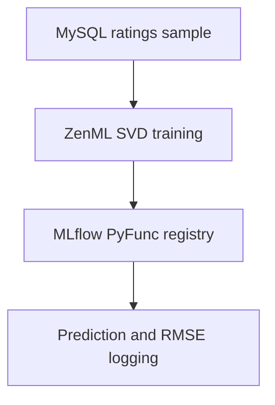

# Movie Recommendations — From Ratings to a Tracked Model
### Recommend unseen films, and keep the training process inspectable.

A movie recommendation service needs to handle both returning viewers and people it has never seen. The FastAPI application scores unseen movies for a known user with Surprise SVD; for an unknown user, it returns highly rated movies with more than 50 ratings.

Try the interaction in the API docs: request `/recommendations/1?n=5` to ask for five recommendations. The response identifies whether the result is personalized or popularity-based.

## Two engineering choices to explore

**Track the model as well as the code.** The ZenML pipeline loads ratings from MySQL, trains SVD, registers an MLflow PyFunc model, and records an RMSE. A custom [SurpriseWrapper](surprise_wrapper.py) adapts Surprise's per-user/item prediction interface to MLflow's DataFrame prediction interface.

**Keep recommendation behavior explicit.** The [API](app/main.py) excludes films a known user has already rated. Its popularity fallback is prepared at startup, using rating counts and average scores rather than returning arbitrary titles.



The tracked training pipeline and the CSV-backed API are separate execution paths. The API loads a Surprise dump from `models/recommendation_model.pkl`; the pipeline registers a PyFunc model in MLflow.

## Recorded experiment

The [exploration notebook](training%20model/Syst%C3%A8me%20de%20Recommandation%20de%20Films.ipynb) includes a recorded **test RMSE of 0.7865**. This is an existing notebook output, not a result reproduced in this documentation update.

In the scripted pipeline, ingestion samples up to 1,000 MySQL ratings. Training uses the full ingested sample and evaluation samples 20% of that same data. Its logged RMSE therefore measures fit on overlapping data and must not be interpreted as an independent test score.

## Run the training workflow

Prerequisites: Git, Conda, Docker Compose, and MovieLens CSV files with `userId`, `movieId`, `rating` and movie metadata. Data files and trained artifacts are supplied separately.

```bash
git clone https://github.com/Jabour-Salahddine/machine-learnia-pipelines.git
cd machine-learnia-pipelines
conda create --name reco-api python=3.9 -y
conda activate reco-api
conda install -c conda-forge scikit-surprise -y
pip install -r requirements.txt
pip install pymysql "zenml[server]"
docker compose up -d
```

On Windows, the Conda package avoids compiling Surprise locally. Keep its installed version compatible with the requirements. The Compose file starts MySQL on port 3306 and MLflow on port 5000; its credentials are local demonstration defaults.

Place `movies.csv` and `ratings.csv` in `data/`, then import once into an empty database. The import appends rows:

```bash
python scripts/import_data.py
zenml integration install mlflow -y
zenml experiment-tracker register mlflow_tracker --flavor=mlflow --tracking_uri=http://localhost:5000
zenml stack register reco-stack -a default -o default -e mlflow_tracker
zenml stack set reco-stack
python run.py
```

Use a fresh ZenML workspace for these example component names. Inspect runs at http://localhost:5000. See [ingestion](steps/ingest_data.py), [training](steps/train_modell.py), and [evaluation](steps/evaluate_model.py) for the exact parameters.

## Run the API

Export a compatible model using Surprise's dump format to `models/recommendation_model.pkl`. For this API path, supply **`data/movie.csv` and `data/rating.csv`** (singular filenames); the importer uses the plural filenames above.

```bash
uvicorn app.main:app --reload
curl "http://127.0.0.1:8000/recommendations/1?n=5"
```

Open http://127.0.0.1:8000/docs. If the required resources cannot be loaded, recommendation requests return HTTP 503.

For container execution with externally supplied data and model files:

```bash
docker build -t reco-api-image .
docker run --rm -p 8000:8000 -v "$(pwd)/data:/app/data" -v "$(pwd)/models:/app/models" reco-api-image
```

MovieLens data credit: GroupLens Research. Follow the terms distributed with the dataset you use.
